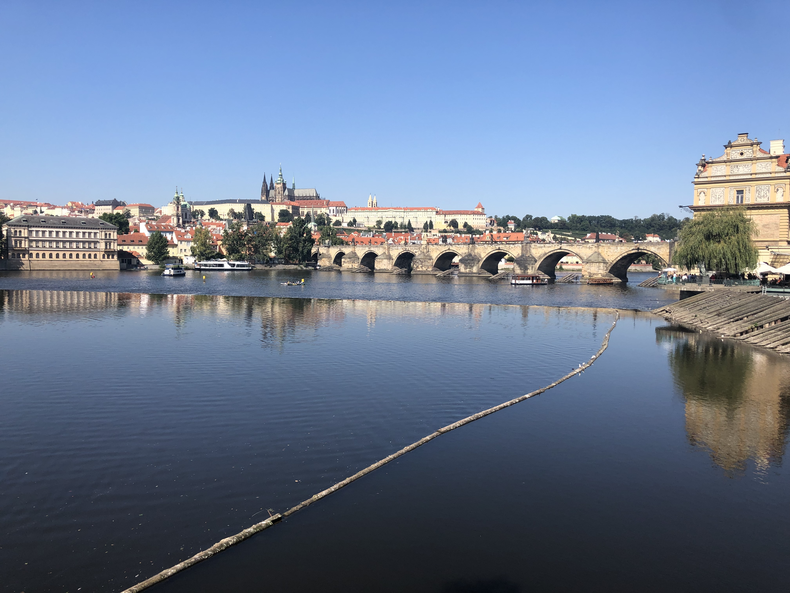

# Content-Aware Scaling

This project is a small, from-scratch implementation of seam carving, the technique that lets you shrink an image without simply squashing it or cropping off its edges. Instead of scaling every pixel equally, seam carving looks for the parts of the picture that nobody will miss, such as stretches of clear sky, blank walls, or smooth gradients, and quietly removes them one thin line at a time. The interesting content stays intact while the empty space around it collapses.

| Original (4032 × 3024) | Carved (3978 × 1249) |
| :---: | :---: |
|  |  |

## How it works

The process begins by deciding how "busy" each pixel is. For every pixel, the code compares its colour to each of its eight neighbours, takes the squared difference across the red, green, and blue channels, and averages the result. A pixel sitting in the middle of a flat, uniform region scores close to zero, whereas a pixel on an edge or inside a detailed texture scores much higher. Together these scores form a distance matrix that acts as a map of where the image's visual information lives.

With that map in hand, the next step is to find a seam: a connected path running from the top of the image to the bottom that passes through exactly one pixel per row, where each step may move at most one column to the left or right. Among all such paths, we want the one whose pixels have the lowest average distance, since that is the path that cuts through the least important content. Because every seam has the same length, minimising the average is the same as minimising the sum, which makes this a classic dynamic programming problem. Each cell's cost is its own distance plus the cheapest of the three cells above it, and once the bottom row is filled in, the cheapest endpoint is traced back up to recover the full path.

Once the best seam is found, it is removed and every pixel to its right shifts over by one, leaving an image that is a single column narrower. This repeats until the cheapest remaining seam is no longer cheap enough, meaning its average distance has reached a chosen threshold. At that point, any further removal would start cutting into content that actually matters, so carving stops. Rather than asking you to pick a target width up front, the threshold lets the image decide for itself how much empty space it can afford to lose.

Shrinking the height works in exactly the same way. Rather than duplicating all of the logic for horizontal seams, `carve_rows` transposes the image so that rows become columns, runs the ordinary vertical carve, and transposes the result back.

## Keeping it fast

A full-resolution phone photo has over twelve million pixels, and a naive implementation would recompute the entire distance matrix after every single seam. That quickly becomes unbearably slow, so the code takes a few steps to avoid unnecessary work.

The most important of these is that the distance matrix is only computed in full once. When a seam is removed, the matrix is carved along the same path as the image, so it stays aligned with the pixels it describes. The only pixels whose scores actually change are the ones that gained new neighbours, and those all sit in a narrow band on either side of the removed seam. The code recomputes distances for just that band (three columns on each side by default) and leaves the rest of the matrix untouched.

The two hot loops, the dynamic programming pass and the routine that copies pixels around a removed seam, are compiled to machine code with Numba. Their compiled versions are cached on disk, so only the very first run pays the compilation cost. The initial distance matrix, meanwhile, is built with vectorised NumPy slicing, comparing the whole image against a shifted copy of itself in each of the eight directions instead of looping over pixels one by one.

## Getting started

The project uses [uv](https://docs.astral.sh/uv/) to manage its dependencies, which are NumPy, Pillow, Numba, and tqdm. It requires Python 3.10 or newer. To install everything, run:

```bash
uv sync
```

The carving script currently reads `IMG_6081.png` from the project directory, so place the image you want to process there under that name (or edit the filename at the bottom of `parse_image.py`). Then run:

```bash
uv run python parse_image.py
```

The script first removes vertical seams to narrow the image, then removes horizontal seams to shorten it, displaying a progress bar along the way that shows the current size and the cost of the most recent seam. When it finishes, it prints how many seams were taken out in each direction and saves the result as `carved.png`.

## Tuning the result

The behaviour is controlled mostly by the threshold, which is set to `1e-3` in the script. Because pixel values are scaled to lie between zero and one, this number represents a very small average colour difference, so only genuinely flat regions get removed. Raising it lets the carver eat further into textured areas and produces a more aggressive shrink, while lowering it makes the carver more conservative.

If you would rather stop after a fixed number of seams regardless of their cost, both `carve` and `carve_rows` accept a `max_paths` argument. They also accept a `band` argument that controls how many columns on each side of a removed seam are recomputed, and a `verbose` flag that turns the progress bar on or off. Each function returns the carved image together with the list of seams it removed and their average costs, which is handy if you want to visualise where the cuts were made.

## Project layout

Nearly all of the work happens in `parse_image.py`, which contains the image loading and saving helpers, the distance calculations, the seam finding, and the carving loop itself. It also includes `find_min_paths_from_each_start`, an alternative that computes the best seam beginning at every column of the top row in a single pass; it isn't used by the main carving loop, but it can be useful for exploring the structure of an image. The `main.py` file is just a placeholder for now.
