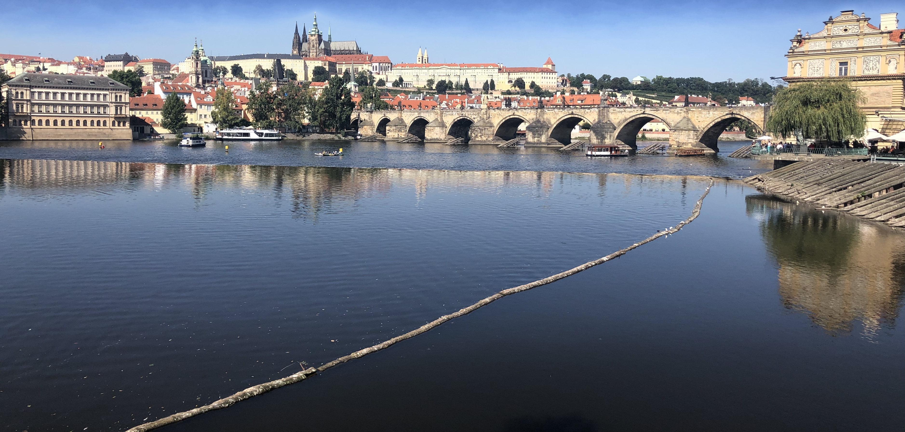
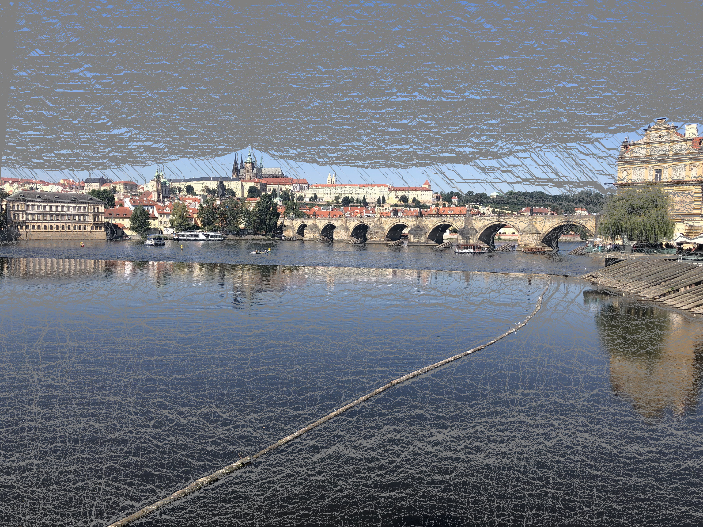
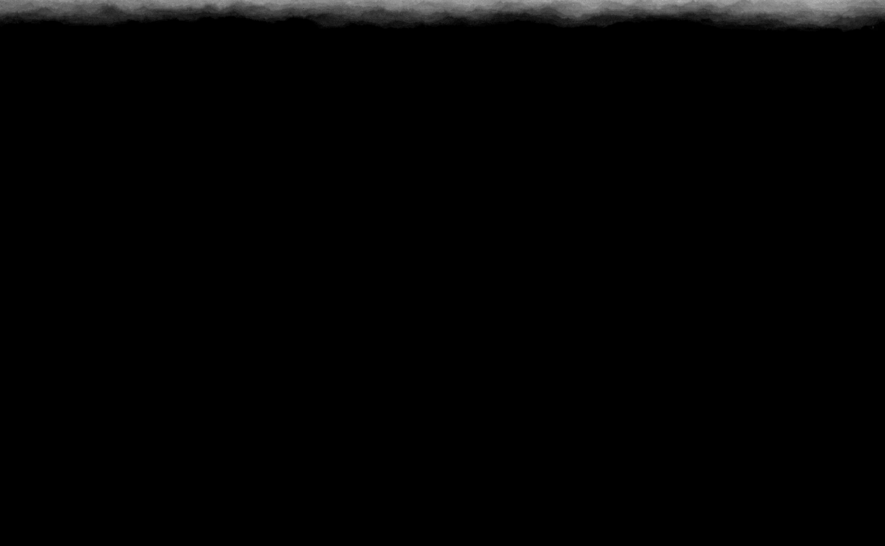

# Content-Aware Scaling

This project is a small, from-scratch implementation of seam carving, the technique that lets you shrink an image without simply squashing it or cropping off its edges. Instead of scaling every pixel equally, seam carving looks for the parts of the picture that nobody will miss, such as stretches of clear sky, rippling water, or smooth gradients, and quietly removes them one thin line at a time. The interesting content stays intact while the empty space around it collapses.

| Original (4032 × 3024) | Carved (3074 × 1443) |
| :---: | :---: |
|  |  |

## Where did the pixels go?

Looking at the two images above, it is fair to wonder whether the carver did anything cleverer than crop the frame. There are two ways to check. The first is to look directly at what was taken out: as the carver works, it records every path it removes, and once it finishes those paths are mapped back onto the original photograph and painted flat grey. The second is to line the carved image up with the original along their bottom-left corners and subtract them. If the carved image were nothing more than a crop, every pixel would match its counterpart and the difference would be completely black. The two views are shown side by side below, with the difference averaged across the colour channels and rescaled so that the largest difference is white.

| Removed pixels, greyed out on the original | Difference, aligned at the bottom |
| :---: | :---: |
|  |  |

The greyed-out image answers the question most directly. In this run the carver removed 958 vertical paths and 1,581 horizontal ones, which together account for nearly two thirds of the original pixels, and they are spread across the whole frame rather than taken from its edges. The sky is almost entirely gone, and the river is covered in a fine net of removed paths, because joins between ripples look just like more ripples. The paths flow around the floating log rather than through it, and they largely leave the bridge, the city, and the reflection of the building on the right alone, threading between them through trees and gaps where they can.

The difference image tells the same story from the other side. Because the carver removed columns as well as rows, nothing lines up for long: the log appears twice, once where it sits in the original and once where it ended up after the water around it was thinned out, and the city shows as a bright ghost of itself because every building has moved. A crop would have produced a black image; this one is full of displaced structure. Running `uv run python parse_image.py` writes both `carved.png` and `removed.png`, and running `uv run python diff_images.py` afterwards regenerates `diff.png`.

## How it works

The heart of the method is a question about each possible cut: if we removed this pixel, would anyone notice? When a pixel is taken out of a row, its left and right neighbours end up side by side, and if the path stepped diagonally to get there, the pixel above also becomes a new neighbour of one of them. Rather than asking how busy the removed pixel was, the carver looks at these new joins and asks how different the pixels on either side of them are. This approach is known as forward energy, because it measures the damage a removal will cause rather than the content it takes away.

A colour difference on its own is not enough to judge visibility, though, because the same step that is glaring in a smooth sky is invisible inside rippling water. So each join is measured against how much its surroundings normally vary. That variability is estimated with the median absolute deviation of neighbouring brightness differences over a window roughly sixty pixels across. Using differences rather than raw brightness means a smooth gradient counts as calm, and using a median means a single sharp edge, such as the floating log, is treated as an outlier instead of inflating the estimate.

Dividing a join's colour difference by the local variability gives a number, z, that says how unusual the join is for its neighbourhood. A join of about one unit is exactly what the region already looks like, so the carver only charges for the part beyond that, using a cost of max(0, z − 1). Joins inside water or sky therefore cost nothing at all, while joins that would break the log, the bridge, or the edge of a building remain expensive. A small floor of one 8-bit brightness level keeps perfectly flat regions from dividing by zero.

With these costs, the next step is to find a seam: a connected path running from the top of the image to the bottom that passes through exactly one pixel per row, where each step may move at most one column to the left or right. Among all such paths, we want the one with the lowest total cost, which makes this a classic dynamic programming problem. Each cell's cost is the cheapest of the three ways of arriving from the row above, each with its own join cost, and once the bottom row is filled in, the cheapest endpoint is traced back up to recover the full path.

Once the best seam is found, it is removed and every pixel to its right shifts over by one, leaving an image that is a single column narrower. This repeats until the cheapest remaining seam is no longer cheap enough, meaning its average cost per row has reached a chosen threshold. Shrinking the height works in exactly the same way. Rather than duplicating all of the logic for horizontal seams, `carve_rows` transposes the image so that rows become columns, runs the ordinary vertical carve, and transposes the result back.

## Keeping it fast

A full-resolution phone photo has over twelve million pixels, and every removed seam requires a fresh search across all of them, so the code is built to keep each search cheap.

The join costs are worked out on the fly inside the seam search itself, straight from the image and the variability map, so there is no separate cost map to keep in step with the image. After each removal, only the image and the variability map need to be shifted. The variability map is computed just once at the start, because removing a thin path barely changes how textured a region is, and it is calculated on a grid that samples every fourth pixel before being scaled back up.

The two hot loops, the seam search and the routine that copies pixels around a removed seam, are compiled to machine code with Numba and cached on disk, so only the very first run pays the compilation cost. The seam search is also compiled with relaxed floating-point rules, which on this photo brings a full search down to roughly six hundredths of a second.

## Getting started

The project uses [uv](https://docs.astral.sh/uv/) to manage its dependencies, which are NumPy, Pillow, Numba, and tqdm. It requires Python 3.10 or newer. To install everything, run:

```bash
uv sync
```

The carving script currently reads `IMG_6081.png` from the project directory, so place the image you want to process there under that name (or edit the filename at the bottom of `parse_image.py`). Then run:

```bash
uv run python parse_image.py
```

The script first removes vertical seams to narrow the image, then removes horizontal seams to shorten it, displaying a progress bar along the way that shows the current size and the cost of the most recent seam. When it finishes, it prints how many seams were taken out in each direction, saves the result as `carved.png`, and saves the greyed-out map of removed pixels as `removed.png`.

## Tuning the result

The amount of carving is controlled by the threshold, which is set to `0.1` in the script. Because a join that looks natural costs nothing, most seams through sky and water are nearly free, and the threshold decides how much visible damage the carver will accept before stopping. The scale is sensitive: on the example photo, a threshold of `0.1` removes about two thirds of the pixels while protecting the main subjects, whereas a threshold of `1` keeps going until almost nothing is left. Choosing this number by hand is admittedly arbitrary, and a natural next step is to let the carver find the point where seam costs start to climb and stop there on its own.

The variability measurement has a few knobs of its own. `mad_radius` and `mad_stride` together set the size of the window used to measure variability, which should be comfortably wider than the thickest edge you want protected, and `mad_floor` sets the smallest variability the carver will assume. An optional `step_penalty` adds a fixed charge to every diagonal step, which keeps seams straighter in smooth gradients; it defaults to zero, since forward energy already charges diagonal steps for any misalignment they cause.

If you would rather stop after a fixed number of seams regardless of their cost, both `carve` and `carve_rows` accept a `max_paths` argument, along with a `verbose` flag that turns the progress bar on or off. Each function returns the carved image together with the list of seams it removed and their average costs.

## Project layout

Nearly all of the work happens in `parse_image.py`, which contains the image loading and saving helpers, the variability estimate, the forward-energy seam search, and the carving loop itself. The same file maps the removed paths back onto the original to produce `removed.png`. It also includes `find_min_paths_from_each_start`, which computes the best seam beginning at every column of the top row in a single pass over any cost matrix; it isn't used by the main carving loop, but it can be useful for exploring the structure of an image. The small `diff_images.py` script produces the bottom-aligned difference image shown above.
